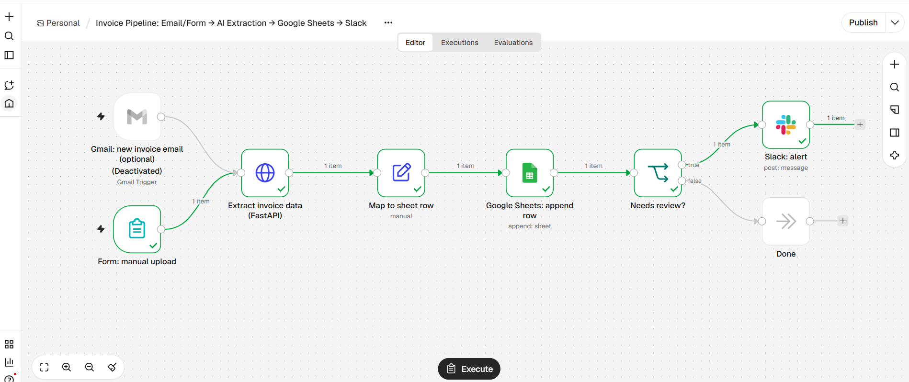
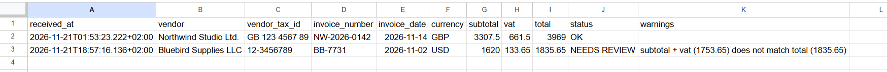
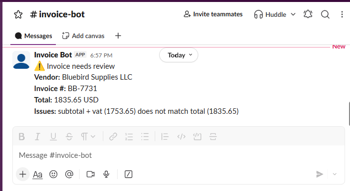

# Invoice Automation with n8n

**Invoices arrive by email → AI extracts the data → a row lands in Google Sheets → Slack pings you only when something looks wrong.**

An n8n workflow built on top of [invoice-extractor](https://github.com/Freedomnet2000/invoice-extractor), a FastAPI service that turns invoice PDFs and images (Hebrew or English) into validated JSON.

```
 Gmail (invoice attachment) ─┐
                             ├─► FastAPI extractor ─► map fields ─► Google Sheets ─► Needs review? ─┬─► Slack alert
 Web form (manual upload) ───┘        (LLM + checks)                    (append row)                └─► done
```

## Screenshots

**The workflow** – a form upload (or Gmail) goes through AI extraction, lands in Google Sheets, and branches on validation.



**Google Sheets log** – a clean invoice is marked `OK`; an invoice whose printed total doesn't add up is marked `NEEDS REVIEW` with the reason.



**Slack alert** – sent only for the invoice that needs a human.



## What it does

1. **Two ways in** – a Gmail trigger watches for emails with invoice attachments, and an n8n web form lets anyone upload a file by hand.
2. **Extraction** – the file is posted to the `invoice-extractor` API, which reads it with an LLM (OpenAI or Claude) and cross-checks the totals.
3. **Logging** – vendor, tax ID, invoice number, date, currency, subtotal, VAT, total and status are appended to a Google Sheet.
4. **Exceptions only** – if the API flagged a problem (totals don't add up, missing total, low confidence), the row is marked `NEEDS REVIEW` and a Slack message lists the issues. Clean invoices go through silently.

## Run it locally

Requires Docker Desktop. Put this folder next to `invoice-extractor`:

```
upwork/
├── invoice-extractor/
└── invoice-automation-n8n/
```

Windows: double-click **`run.bat`**. If Docker can't download the n8n image on your network, start the extractor with its own `run.bat` and use **`run-local.bat`** here instead – it runs n8n with Node.js (`npx n8n`). Or:

```bash
docker compose up -d --build
docker compose exec n8n n8n import:workflow --input=/workflows/invoice-pipeline.json
```

- n8n: **http://localhost:5678**
- Extraction API: **http://localhost:8000**

Then in n8n:

1. Open **Invoice Pipeline** from the workflow list.
2. Add credentials for **Gmail**, **Google Sheets** and **Slack** (each node shows a "Create credential" button).
3. In **Google Sheets: append row**, paste your sheet URL. Create a tab named `Invoices` with these headers in row 1:
   `received_at, vendor, vendor_tax_id, invoice_number, invoice_date, currency, subtotal, vat, total, status, warnings`
4. In **Slack: alert**, pick the channel (the bot must be invited to it: `/invite @YourBot`). A Slack app needs only the `chat:write` and `channels:read` bot scopes.
5. Click **Execute workflow** and upload an invoice through the form, or send yourself an email with "invoice" in the subject and a PDF attached. The extractor repo includes two test files: `samples/sample-invoice-en.pdf` (clean) and `samples/sample-invoice-mismatch.pdf` (total intentionally wrong – triggers the Slack alert).

No Gmail? Delete the Gmail node; the form trigger works on its own.

## Design notes

- **The API does the hard part, n8n does the plumbing.** Extraction, validation and model choice live in versioned, tested Python code. The workflow only routes data, so it stays small and easy for a client to change.
- **Alert on exceptions, not on every invoice.** Validation warnings from the API drive the branch, so people only look at invoices that need a human.
- **Any trigger works.** The HTTP node picks up whichever binary field the trigger produced (`Object.keys($binary)[0]`), so Gmail, the form, Outlook, Drive or a webhook can be swapped in without touching the rest.
- **Configurable endpoint.** The API URL comes from `INVOICE_EXTRACTOR_URL`, so the same workflow runs locally, in Docker or against a deployed service.

## Tested

Run end to end on n8n 2.35 with real Google Sheets and Slack connections: a clean invoice was logged as `OK`, and an invoice with a wrong printed total was logged as `NEEDS REVIEW` and triggered the Slack alert (see screenshots).

## Limitations / next steps

- Processes the first attachment of each email; multi-attachment emails need a split step.
- Duplicate detection (same vendor + invoice number) before appending.
- Push approved rows to accounting software (e.g. Green Invoice, QuickBooks, Xero).
